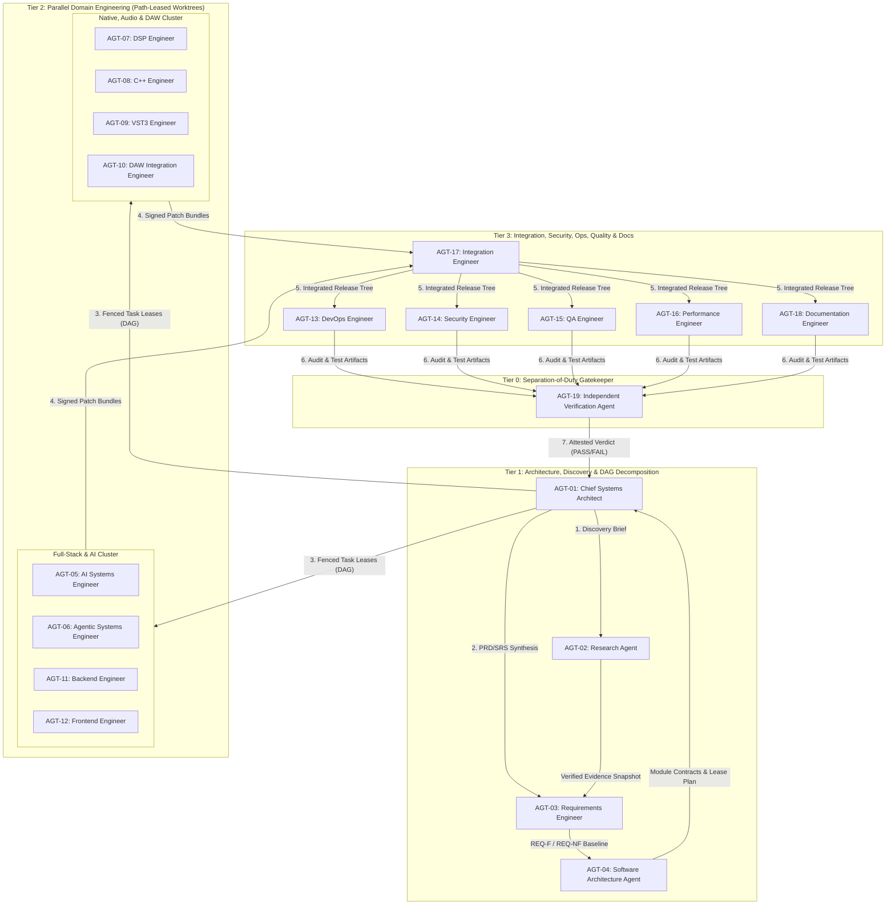

# AETHER FORGE — SPECIALIST AGENT REGISTRY & ORCHESTRATION ARCHITECTURE (`AGENT_REGISTRY.md`)

- **Version:** `1.0.0`
- **Status:** Normative Multi-Agent Systems Architecture Baseline
- **Authority:** Lead Multi-Agent Systems Architect (`ARCH-03` Specialist Agent Network)
- **Traceability:** `REQ-F-0100..0211`, `REQ-NF-0100..0501`, `ADR-0001..0012`, `MASTER_ARCHITECTURE.md`

---

## 1. Specialist Agent Network Roster (`AGT-01` .. `AGT-19`)

AETHER FORGE decomposes complex systems engineering into **19 deterministic, least-privilege specialist agents** organized across four hierarchical tiers. No agent holds wildcard (`*`) tool permissions, and no authoring agent (`AGT-01`..`AGT-18`) can self-certify completion without passing `AGT-19` (`independent-verification-agent`).

| Agent ID | Canonical Slug | Agent Title | Hierarchy Tier | Max Autonomy | RBAC Role | Primary Specification |
| :--- | :--- | :--- | :--- | :--- | :--- | :--- |
| **`AGT-01`** | `chief-systems-architect` | Chief Systems Architect Agent | Tier 1: Architecture & Command | `L3` | `Architect` | [tier-1-architecture-discovery.md](file:///C:/Users/blago/Desktop/AETHERFORGE/AGENT_SPECIFICATIONS/tier-1-architecture-discovery.md) |
| **`AGT-02`** | `research-agent` | Research Agent | Tier 1: Architecture & Discovery | `L3` | `Architect` | [tier-1-architecture-discovery.md](file:///C:/Users/blago/Desktop/AETHERFORGE/AGENT_SPECIFICATIONS/tier-1-architecture-discovery.md) |
| **`AGT-03`** | `requirements-engineer` | Requirements Engineer Agent | Tier 1: Architecture & Discovery | `L3` | `Architect` | [tier-1-architecture-discovery.md](file:///C:/Users/blago/Desktop/AETHERFORGE/AGENT_SPECIFICATIONS/tier-1-architecture-discovery.md) |
| **`AGT-04`** | `software-architecture-agent` | Software Architecture Agent | Tier 1: Architecture & Discovery | `L3` | `Architect` | [tier-1-architecture-discovery.md](file:///C:/Users/blago/Desktop/AETHERFORGE/AGENT_SPECIFICATIONS/tier-1-architecture-discovery.md) |
| **`AGT-05`** | `ai-systems-engineer` | AI Systems Engineer | Tier 2A: AI & Full-Stack | `L3` | `Operator` | [tier-2a-ai-agentic-engineering.md](file:///C:/Users/blago/Desktop/AETHERFORGE/AGENT_SPECIFICATIONS/tier-2a-ai-agentic-engineering.md) |
| **`AGT-06`** | `agentic-systems-engineer` | Agentic Systems Engineer | Tier 2A: AI & Full-Stack | `L3` | `Operator` | [tier-2a-ai-agentic-engineering.md](file:///C:/Users/blago/Desktop/AETHERFORGE/AGENT_SPECIFICATIONS/tier-2a-ai-agentic-engineering.md) |
| **`AGT-07`** | `dsp-engineer` | DSP Engineer | Tier 2B: Native, Audio & DAW | `L3` | `Operator` | [tier-2b-native-audio-daw-engineering.md](file:///C:/Users/blago/Desktop/AETHERFORGE/AGENT_SPECIFICATIONS/tier-2b-native-audio-daw-engineering.md) |
| **`AGT-08`** | `cpp-engineer` | C++ Engineer | Tier 2B: Native, Audio & DAW | `L3` | `Operator` | [tier-2b-native-audio-daw-engineering.md](file:///C:/Users/blago/Desktop/AETHERFORGE/AGENT_SPECIFICATIONS/tier-2b-native-audio-daw-engineering.md) |
| **`AGT-09`** | `vst3-engineer` | VST3 Engineer | Tier 2B: Native, Audio & DAW | `L3` | `Operator` | [tier-2b-native-audio-daw-engineering.md](file:///C:/Users/blago/Desktop/AETHERFORGE/AGENT_SPECIFICATIONS/tier-2b-native-audio-daw-engineering.md) |
| **`AGT-10`** | `daw-integration-engineer` | DAW Integration Engineer | Tier 2B: Native, Audio & DAW | `L3` | `Operator` | [tier-2b-native-audio-daw-engineering.md](file:///C:/Users/blago/Desktop/AETHERFORGE/AGENT_SPECIFICATIONS/tier-2b-native-audio-daw-engineering.md) |
| **`AGT-11`** | `backend-engineer` | Backend Engineer | Tier 2A: AI & Full-Stack | `L3` | `Operator` | [tier-2a-ai-agentic-engineering.md](file:///C:/Users/blago/Desktop/AETHERFORGE/AGENT_SPECIFICATIONS/tier-2a-ai-agentic-engineering.md) |
| **`AGT-12`** | `frontend-engineer` | Frontend Engineer | Tier 2A: AI & Full-Stack | `L3` | `Operator` | [tier-2a-ai-agentic-engineering.md](file:///C:/Users/blago/Desktop/AETHERFORGE/AGENT_SPECIFICATIONS/tier-2a-ai-agentic-engineering.md) |
| **`AGT-13`** | `devops-engineer` | DevOps Engineer | Tier 3: Ops, Security & Quality | `L2` | `Operator` | [tier-3-ops-security-quality-verification.md](file:///C:/Users/blago/Desktop/AETHERFORGE/AGENT_SPECIFICATIONS/tier-3-ops-security-quality-verification.md) |
| **`AGT-14`** | `security-engineer` | Security Engineer | Tier 3: Ops, Security & Quality | `L3` | `Reviewer` | [tier-3-ops-security-quality-verification.md](file:///C:/Users/blago/Desktop/AETHERFORGE/AGENT_SPECIFICATIONS/tier-3-ops-security-quality-verification.md) |
| **`AGT-15`** | `qa-engineer` | QA Engineer | Tier 3: Ops, Security & Quality | `L3` | `Reviewer` | [tier-3-ops-security-quality-verification.md](file:///C:/Users/blago/Desktop/AETHERFORGE/AGENT_SPECIFICATIONS/tier-3-ops-security-quality-verification.md) |
| **`AGT-16`** | `performance-engineer` | Performance Engineer | Tier 3: Ops, Security & Quality | `L3` | `Reviewer` | [tier-3-ops-security-quality-verification.md](file:///C:/Users/blago/Desktop/AETHERFORGE/AGENT_SPECIFICATIONS/tier-3-ops-security-quality-verification.md) |
| **`AGT-17`** | `integration-engineer` | Integration Engineer | Tier 3: Ops, Security & Quality | `L3` | `Operator` | [tier-3-ops-security-quality-verification.md](file:///C:/Users/blago/Desktop/AETHERFORGE/AGENT_SPECIFICATIONS/tier-3-ops-security-quality-verification.md) |
| **`AGT-18`** | `documentation-engineer` | Documentation Engineer | Tier 3: Ops, Security & Quality | `L3` | `Operator` | [tier-3-ops-security-quality-verification.md](file:///C:/Users/blago/Desktop/AETHERFORGE/AGENT_SPECIFICATIONS/tier-3-ops-security-quality-verification.md) |
| **`AGT-19`** | `independent-verification-agent` | Independent Verification Agent | Tier 0: Independent Gatekeeper | `L3` | `Reviewer` | [tier-3-ops-security-quality-verification.md](file:///C:/Users/blago/Desktop/AETHERFORGE/AGENT_SPECIFICATIONS/tier-3-ops-security-quality-verification.md) |

---

## 2. Hierarchical and Collaborative Orchestration Architecture

AETHER FORGE combines **Hierarchical Command** (top-down DAG decomposition and lease assignment via Temporal durable workflows) with **Contract-Mediated Peer Collaboration** (horizontal interface negotiation and evidence hand-off without direct shared mutable state).

### 2.1 Hierarchical Orchestration Rules
1. **Single Root Decomposer:** Only `AGT-01` (`chief-systems-architect`), assisted by `AGT-04` (`software-architecture-agent`), compiles a `CreativeBrief` into a multi-agent `ExecutionPlan` DAG.
2. **Bounded Delegation Depth (`maxDelegationDepth = 2`):**
   - Depth `0`: Temporal Workflow Coordinator (`@aether-forge/orchestration`) invokes `AGT-01`.
   - Depth `1`: `AGT-01` delegates DAG nodes to Tier 1/2/3 specialists (`AGT-02`..`AGT-18`).
   - Depth `2`: A Tier 2 specialist may request a read-only sub-consultation (e.g., `AGT-09` VST3 Engineer queries `AGT-07` DSP Engineer for filter transfer coefficients or `AGT-02` Research Agent for SDK citations), mediated through the Temporal Coordinator. No Depth `2` task may acquire write leases or spawn Depth `3` subtasks.
3. **Mandatory Independent Gatekeeping:** Every DAG path terminating in a code, schema, DSP, infrastructure, or documentation mutation must route through `AGT-19` (`independent-verification-agent`) before marking the workflow `COMPLETED`.

### 2.2 Collaborative Hand-Off Protocol
Specialists never message each other over unlogged side channels. Peer collaboration operates via **Immutable Artifact Hand-Off Packets** (`SharedContextEnvelope`):
- `AGT-07` (DSP Engineer) produces mathematical filter models + offline golden WAV/metrics → hands off immutable artifact hash to `AGT-08` (C++ Engineer) for lock-free SIMD C++20 implementation → hands off to `AGT-09` (VST3 Engineer) for `IAudioProcessor` parameter binding → verified by `AGT-16` (Performance Engineer) for zero-allocation WCET compliance.
- `AGT-04` (Software Architecture Agent) publishes Zod/OpenAPI/IPC contracts in `contracts/` → `AGT-11` (Backend Engineer) and `AGT-12` (Frontend Engineer) implement against the frozen contract hash concurrently without stepping on each other's files.

---

## 3. Explicit Task Ownership & Concurrency Controls

To guarantee that **no agent ever overwrites another agent's work**, AETHER FORGE enforces **Fenced Path-Lease Concurrency Control** inside `@aether-forge/orchestration` and `@aether-forge/filesystem`.

### 3.1 Task Ownership Lease (`TaskOwnershipLease`)
Before any agent executes a `Tier 1+` write action, the Temporal Coordinator issues a cryptographic `TaskOwnershipLease`:
- `leaseId`: UUIDv4 unique to `(planId, stepId, agentId)`.
- `fenceToken`: Monotonically increasing 64-bit integer per workspace (`1, 2, 3...`). Every tool gateway write request carries `fenceToken`; the worker rejects any write whose `fenceToken` is lower than the path's highest seen token (`STALE_FENCE_TOKEN_REJECTED`).
- `exclusiveWriteGlobs[]`: Disjoint canonical path patterns (e.g., `AGT-11` leases `apps/api/**` and `services/**`; `AGT-12` leases `apps/web/**` and `packages/ui/**`; `AGT-08`/`AGT-09` lease `plugins/vst3/**`).
- `readOnlyGlobs[]`: Shared read-only dependencies (e.g., `contracts/**`, `REFERENCE_BOOK.md`).
- `baseTreeSha256`: Мерkle/Git tree SHA-256 of the leased files at lease acquisition time.

### 3.2 Concurrency Invariants
1. **Disjoint Write-Set Invariant:** Two concurrently executing DAG steps $S_a$ and $S_b$ MUST satisfy:
   $$\text{exclusiveWriteGlobs}(S_a) \cap \text{exclusiveWriteGlobs}(S_b) = \emptyset$$
   If two steps require mutating the same file (e.g., `package.json` or `contracts/src/index.ts`), the System Compiler (`ARCH-04`) serializes them with a strict DAG dependency edge ($S_a \to S_b$) or routes the merge through `AGT-17` (`integration-engineer`).
2. **Optimistic Compare-And-Swap (CAS) on Commit:** When an agent completes its step, the worker verifies that every target file's current pre-write SHA-256 matches the `baseTreeSha256` recorded in the agent's lease. On mismatch, the write aborts with `CONCURRENT_MODIFICATION_CONFLICT` and escalates to `AGT-17` (`integration-engineer`).
3. **Isolated Git Worktrees for Parallel Branches:** When Tier 2 agents execute long-running native builds in parallel, `@aether-forge/git` provisions isolated worktrees under `<workspace>/.aetherforge/worktrees/<leaseId>/` and merges via `AGT-17` fast-forward or 3-way verification.

---

## 4. Shared Context Contracts & Agent Isolation

### 4.1 Shared Context Contract (`SharedContextEnvelope`)
Every agent invocation receives a deterministic, schema-validated `SharedContextEnvelope` (`AGENT_CONTRACTS/multi-agent-contracts.md`):
- `tenantId`, `projectId`, `traceId`, `planId`, `stepId`.
- `briefSnapshotHash`: SHA-256 of the originating `CreativeBrief`.
- `knowledgeSnapshotId`: Pinned `@aether-forge/knowledge` snapshot (`provenanceId` set) so all agents in a workflow reason over identical domain facts.
- `contractVersionHash`: SHA-256 of `contracts/generated/json-schema.json` and `openapi.json`.
- `upstreamArtifacts[]`: Array of `{ producerAgentId, stepId, artifactPath, sha256, mimeType }` produced by completed predecessor steps.
- `agentScratchpadNamespace`: Isolated namespace `memory://<tenantId>/<projectId>/<planId>/<agentId>/` where the agent stores intermediate reasoning without polluting sibling agents' context windows.

### 4.2 Agent Isolation Boundaries
- **Context Window Isolation:** An agent only sees its system prompt, its assigned `SharedContextEnvelope`, and the files matching its `readOnlyGlobs ∪ exclusiveWriteGlobs`. Full conversation histories of other agents are never dumped into a specialist's context window (preventing context poisoning and prompt-injection propagation).
- **Credential & Secret Isolation:** No agent (`AGT-01`..`AGT-19`) ever receives raw API keys, signing keys, or database passwords in its prompt or tool outputs. `ServerSideSecretManager` injects credentials inside the worker host boundary (`TB-2`/`TB-3`) and scrubs stdout/stderr via `redactSecrets()`.
- **Filesystem Sandbox Isolation:** Every file read/write is gated by `OpaPolicyDecisionPoint` (`services/policy/bundles/v1/governance.rego`) checking `(agentId, role, actionTier, canonicalPathScope, fenceToken)`.

---

## 5. Anti-Fabrication & Non-Overwrite Enforcement

### 5.1 Zero-Tolerance Anti-Fabrication Protocol
An agent task output (`AgentTaskOutput`) is rejected at the schema boundary if any of the following rules are violated:
1. **Cryptographic File-Diff Proof:** Every file claimed in `output.modifiedFiles[]` must exist on disk, have a post-execution SHA-256 different from `preExecutionSha256` (unless explicitly declared idempotent), and match a real disk stat check performed by the Worker Host—not self-reported text from the LLM.
2. **Command Exit-Code & Log Binding:** Every claim that a compiler, linter, test suite, or DSP render succeeded must reference a verifiable `WorkerExecutionResult` record containing `exitCode === 0`, `stdoutSha256`, and `durationMs` logged in `AppendOnlyAuditService`.
3. **Explicit Prerequisite Honesty:** If an external toolchain (e.g., `cl.exe`, `cargo`, `pluginval.exe`, `C:\JUCE`) is absent on the host, the agent MUST emit status `BLOCKED_MISSING_PREREQUISITES` with the exact missing binary path—never a mock binary or fabricated pass report.
4. **Independent Verification Separation of Duty (`AGT-19`):** `AGT-19` re-runs the verification commands (`pnpm test`, schema compatibility checks, audio metrics checks, hash comparisons) in a clean read-only context and rejects any task where `authorAgentId === verifierAgentId`.

---

## 6. Escalation Matrix & Failure Recovery

| Failure / Trigger Condition | Detecting Agent | Escalation Target | Automated Action |
| :--- | :--- | :--- | :--- |
| **Ambiguous or Contradictory Requirement** | `AGT-03` / Any Tier 2 Agent | `AGT-01` → Human Operator | Pause step; emit structured clarification request referencing `REQ-F-*`. |
| **Unverified External API / SDK Capability** | Any Tier 2 Agent | `AGT-02` (`research-agent`) | Spawn read-only Depth-2 evidence lookup; tag `unverified_assumptions` if offline docs absent. |
| **Cross-Agent File Lease Collision** | `@aether-forge/orchestration` | `AGT-17` (`integration-engineer`) | Reject stale `fenceToken`; queue reconciliation step in `AGT-17`. |
| **Tier 2/3 Destructive Action Required** | `AGT-13` / `AGT-11` / `AGT-08` | OPA PDP → Human `ApprovalRecord` | Suspend Temporal workflow (`WAITING_FOR_APPROVAL`); resume only on signed human approval. |
| **Security / Secret / Traversal Violation** | `AGT-14` / OPA PDP | `EmergencyStopRegistry` + `AGT-01` | Immediate `DENY`; log hash-chained audit event; trigger project kill-switch on repeated abuse. |
| **Real-Time Audio / WCET Violation** | `AGT-09` / `AGT-16` | `AGT-07` & `AGT-08` | Reject plugin patch; attach WCET/allocation trace; return to `AGT-08` for lock-free refactor. |
| **Independent Verification Failure (`FAIL`)** | `AGT-19` | `AGT-01` + Authoring Agent | Block DAG completion; attach diff/test failure evidence; allow max 2 bounded repair loops before human escalation. |
