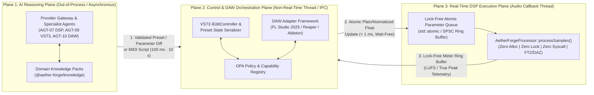

# AETHER FORGE — AUDIO, VST3 & AI DAW DOMAIN ARCHITECTURE (`AUDIO_DOMAIN_ARCHITECTURE.md`)

- **Version:** `1.0.0`
- **Authority:** Chief Audio Systems Architect (`ARCH-05`, `ARCH-07`, `ARCH-09`)
- **Traceability:** `REQ-F-0300..0502`, `REQ-NF-0300..0301`, `ADR-0006`, `ADR-0008`, `ADR-0009`
- **Subsystems:** [DSP_ENGINE/](file:///C:/Users/blago/Desktop/AETHERFORGE/DSP_ENGINE/README.md), [VST3_ENGINE/](file:///C:/Users/blago/Desktop/AETHERFORGE/VST3_ENGINE/README.md), [DAW_ADAPTER_FRAMEWORK/](file:///C:/Users/blago/Desktop/AETHERFORGE/DAW_ADAPTER_FRAMEWORK/README.md), [AUDIO_TEST_FRAMEWORK/](file:///C:/Users/blago/Desktop/AETHERFORGE/AUDIO_TEST_FRAMEWORK/README.md), [DOMAIN_KNOWLEDGE_PACKS/](file:///C:/Users/blago/Desktop/AETHERFORGE/DOMAIN_KNOWLEDGE_PACKS/README.md)

---

## 1. The Three-Plane Audio Separation Law (AI Reasoning vs. Control Plane vs. Real-Time DSP)

A foundational architectural invariant of AETHER FORGE (`ADR-0008`) is the strict physical and temporal isolation between **AI Reasoning**, **Control-Plane Operations**, and **Real-Time DSP Execution**.

### Hard Comparison Matrix across the Three Planes

| Architectural Dimension | Plane 1: AI Reasoning Plane | Plane 2: Control & DAW Plane | Plane 3: Real-Time DSP Plane |
| :--- | :--- | :--- | :--- |
| **Execution Context** | Node.js Control Plane / Out-of-Process Worker | Plugin UI Thread (`IEditController`), DAW Python Controller Thread, Worker IPC | Host Audio Hardware Thread (`IAudioProcessor::process` / ASIO / WASAPI) |
| **Time Horizon / Latency** | $100\text{ ms} \dots 30\text{ s}$ | $1\text{ ms} \dots 50\text{ ms}$ | **Hard Deadline:** $T_{\text{deadline}} = N / f_s$ ($1.333\text{ ms}$ at $N=64, f_s=48\text{ kHz}$; target $\text{WCET} < 400\ \mu\text{s}$) |
| **Memory Allocation** | Dynamic heap & garbage collection permitted | Bounded heap allocation permitted (`setState`, preset load, `.flp` parse) | **Strictly 0 heap allocations** after `prepare()` (`new`/`malloc`/`free`/`delete` forbidden) |
| **Synchronization** | Async/await, Temporal durable mutexes, DB transactions | Non-blocking UI queues, atomic swaps | **100% Wait-Free / Lock-Free** (`std::atomic` `memory_order_relaxed`/`acquire`/`release` only) |
| **I/O & Network** | HTTPS LLM APIs, PostgreSQL/`pgvector`, disk WAL | Scoped local IPC, preset disk I/O, MIDI ports | **Zero syscalls, zero file I/O, zero logging, zero sockets, zero exceptions (`noexcept`)** |
| **Determinism** | Schema-constrained (`Zod`), fallback-routed | Deterministic state machine & capability negotiation | **Bit-identical IEEE 754 sample determinism** (subnormals $< 10^{-15}$ flushed to zero) |

---

## 2. Subsystem A — Modular DSP Engine (`DSP_ENGINE/`)

Designed as a reusable, zero-dependency mathematical DSP library supporting both offline batch mastering/verification and real-time block processing:
1. **Audio Ingestion & Synthesis (`AudioBuffer64` & RIFF WAV Codec):**
   - Multi-channel de-interleaved 64-bit float (`Float64Array`) and 32-bit float (`Float32Array`) buffers.
   - Deterministic 24-bit/32-bit float RIFF/WAVE encoder and parser plus analytical signal generators (sine, Dirac impulse, step transient, white noise).
2. **Composable DSP Algorithm Library:**
   - **RBJ Audio EQ Cookbook Biquad Filter (`BiquadFilterDsp`):** Direct Form II Transposed implementation supporting `LOWPASS`, `HIGHPASS`, `BANDPASS`, `NOTCH`, `PEAKING_EQ`, `LOW_SHELF`, and `HIGH_SHELF`.
   - **Feed-Forward Soft-Knee Compressor (`DynamicsCompressorDsp`):** Attack/release envelope follower ($\alpha = \exp(-1 / (\tau \cdot f_s))$), threshold, ratio, knee width, and makeup gain.
   - **Transient Shaper (`TransientShaperDsp`):** Dual-envelope differential detector separating fast attack transients from sustain body.
   - **Brickwall True-Peak Limiter (`BrickwallLimiterDsp`):** Instantaneous ceiling clamping with exponential release recovery.
   - **1-Pole Exponential Parameter Smoother (`ParameterSmootherDsp`):** Zipper-noise-free sample-accurate parameter interpolation.
3. **Measurement & Validation (`AudioMeasurementAnalyzer`):**
   - Computes `integratedLufs` (ITU-R BS.1770-4 K-weighted), `truePeakDbtp` (4x parabolic inter-sample interpolation), `rmsDbfs`, `crestFactorDb`, `dcOffset`, `zeroCrossingRate`, `clippingRatio`, `spectralCentroidHz`, and `thdPlusNoiseDb`.

---

## 3. Subsystem B — Reusable VST3 Plugin Architecture (`VST3_ENGINE/`)

Decouples plugin metadata, parameter laws, preset persistence, and host lifecycle from any single audio effect:
1. **Normalized $\leftrightarrow$ Physical Parameter Registry (`Vst3ParameterRegistry`):**
   - Maps Steinberg VST3 normalized $[0.0, 1.0]$ automation values to physical ranges (`dB`, `Hz`, `%`, `ms`, `ratio`) with deterministic clamping, step quantization, and `kCanAutomate` / `kIsBypass` flags.
2. **Processor / Controller Split (`Vst3ProcessorInstance` & `Vst3EditController`):**
   - Models the exact Steinberg VST3 `IAudioProcessor` and `IEditController` split: controller edits enqueue lock-free `ParameterChangePoint` events (`sampleOffset`, `normalizedValue`) consumed sample-accurately during `processBlock()`.
3. **Versioned State & Preset Persistence (`Vst3PresetManager`):**
   - Serializes processor & controller state into deterministic, SHA-256-authenticated preset chunks (`AETHER_VST3_PRESET_V1`) supporting factory banks, user presets, and schema migration.
4. **Host Compatibility & Torture Simulator (`Vst3HostCompatibilityHarness`):**
   - Verifies variable block sizes ($1, 17, 64, 256, 1024, 4096$ samples), zero-sample edge blocks, sample-rate transitions ($44.1 \to 48 \to 96\text{ kHz}$), bypass continuity, denormal burst immunity, and lossless state round-trips.

---

## 4. Subsystem C — Multi-DAW Adapter Framework (`DAW_ADAPTER_FRAMEWORK/`)

Replaces hardcoded DAW logic with a capability-negotiated **Ports-and-Adapters (`IDawAdapter`)** architecture:
1. **DAW Capability Registry (`DawCapabilityRegistry`):**
   - Classifies every DAW operation across four governance levels: `SUPPORTED_READONLY`, `SUPPORTED_CONTROLLER_BRIDGE`, `SUPPORTED_EXPORT_IMPORT`, and `UNSUPPORTED_FORBIDDEN`.
2. **Production Target #1 — FL Studio 2025 (`FlStudio2025DomainAdapter`):**
   - Verified against workstation binary `C:\Program Files\Image-Line\FL Studio 2025\FL64.exe` (`25.1.6.4997`).
   - Provides read-only `.flp` (`FLhd`/`FLdt`) binary project inspection, channel/mixer routing graph validation, deterministic MIDI note pattern transformation, and FL Studio Python MIDI Controller script generation (`transport`, `channels`, `mixer`, `patterns`, `plugins`).
   - **Zero Undocumented Assumptions:** Explicitly refuses `direct_flp_binary_mutation`, `fl_engine_dll_memory_injection`, and `undocumented_window_message_spoofing` with `DAW_CAPABILITY_UNSUPPORTED`.
3. **Multi-DAW Replaceability (`ReaperRppDomainAdapter` & `AbletonOscDomainAdapter`):**
   - Implements the identical `IDawAdapter` contract for Cockos REAPER (`.rpp` text chunk inspection) and Ableton Live (Live Object Model OSC bridge), proving zero vendor lock-in.
