# AETHER FORGE — 12-STAGE SYSTEM COMPILER PIPELINE (`COMPILATION_PIPELINE.md`)

- **Version:** `1.0.0`
- **Subsystem:** `ARCH-04` (System Compiler)
- **Implementation:** [SYSTEM_COMPILER/src/index.ts](file:///C:/Users/blago/Desktop/AETHERFORGE/SYSTEM_COMPILER/src/index.ts)
- **Schemas:** [SPECIFICATION_SCHEMAS/compiler-schemas.ts](file:///C:/Users/blago/Desktop/AETHERFORGE/SPECIFICATION_SCHEMAS/compiler-schemas.ts) & [project-specification.schema.json](file:///C:/Users/blago/Desktop/AETHERFORGE/SPECIFICATION_SCHEMAS/project-specification.schema.json)
- **Verification Suite:** [COMPILER_TESTS/system-compiler.test.ts](file:///C:/Users/blago/Desktop/AETHERFORGE/COMPILER_TESTS/system-compiler.test.ts)

---

## 1. Compiler Architecture & Supported Input Modalities

The AETHER FORGE System Compiler (`AetherForgeSystemCompiler`) is a deterministic, multi-pass engineering specification compiler. It ingests heterogeneous project inputs across **6 canonical input types** and lowers them through **12 strongly typed intermediate representations (IRs)** into a cryptographically hashed `CompiledEngineeringSpecification`.

### Supported Input Types (`CompilerInputTypeSchema`)
1. `PRODUCT_DIRECTION` — Executive vision, product charter, target personas, and value propositions.
2. `NATURAL_LANGUAGE_REQUIREMENTS` — Prose functional and non-functional user stories or quantitative constraints.
3. `PROCESS_DESCRIPTION` — Operational workflows, approval chains, release promotion rules, or state transitions.
4. `EXISTING_REPOSITORY` — File tree manifests, `package.json`/`CMakeLists.txt`/`Cargo.toml` descriptors, and existing module boundaries.
5. `TECHNICAL_DOCUMENT` — DSP mathematical equations, binary format specs (e.g., `.flp` `FLhd`/`FLdt`), or RFCs/ADRs.
6. `EXISTING_SYSTEM_ARCHITECTURE` — Structural subsystem topologies, trust boundaries (`TB-1..TB-4`), and interface contracts.

---

## 2. The 12-Stage Deterministic Compilation Pipeline

```mermaid
flowchart TD
    IN["Multi-Modal Inputs (6 Types):\nProduct Direction | NL Requirements | Process Description\nExisting Repo | Technical Document | System Architecture"]
    S01["Stage 01: Intent Extraction\n(IntentExtractionIr)"]
    S02["Stage 02: Requirement Extraction\n(REQ-F-XXXX & REQ-NF-XXXX)"]
    S03["Stage 03: Ambiguity Detection\n(AMB-XXXX Blocking & Advisory)"]
    S04["Stage 04: Domain Classification\n(10 Core Domains -> AGT-01..AGT-19)"]
    S05["Stage 05: Capability Mapping\n(Native | External Tool | Approval | Unsupported)"]
    S06["Stage 06: Technical Research Requests\n(RES-XXXX -> AGT-02 Evidence Probes)"]
    S07["Stage 07: Architecture Generation\n(Subsystems ARCH-01..11, TB-1..4, ADRs)"]
    S08["Stage 08: Component Decomposition\n(COMP-XXXX + Disjoint Write Globs)"]
    S09["Stage 09: Dependency Graph Generation\n(Kahn Topological Sort + Cycle/Missing Check)"]
    S10["Stage 10: Workflow Generation\n(TASK-XXXX + Fence Tokens + Terminal AGT-19)"]
    S11["Stage 11: Test Specification Generation\n(TEST-XXXX Oracles -> AGT-15/16/19)"]
    S12["Stage 12: Acceptance Criteria Generation\n(AC-XXXX Gates -> AGT-19)"]
    VAL["Semantic Validator & 4-Way Traceability Engine\n(REQ <-> COMP <-> TASK <-> TEST <-> AC)"]
    OUT["CompiledEngineeringSpecification (v1.0.0)\n+ SHA-256 Digest"]

    IN --> S01 --> S02 --> S03 --> S04 --> S05 --> S06 --> S07 --> S08 --> S09 --> S10 --> S11 --> S12 --> VAL --> OUT
```

### Stage-by-Stage Transformation Rules
1. **Stage 01 — Intent Extraction:** Normalizes all input artifacts, extracts the primary engineering objective, identifies target personas (`Principal Engineer`, `Audio DSP Architect`, `Security Reviewer`, `Release Manager`), and establishes the maximum project autonomy cap (`L1..L4`).
2. **Stage 02 — Requirement Extraction:** Extracts explicit structured requirements and parses natural-language directives (`MUST`, `SHALL`, `<=`, `>=`, latency/LUFS/dBTP/WCET metrics) into canonical `REQ-F-XXXX` and `REQ-NF-XXXX` records with quantitative thresholds (`metricName`, `thresholdOperator`, `thresholdValue`, `unit`), action tiers (`0..3`), and capability tags.
3. **Stage 03 — Ambiguity Detection:** Scans requirement statements for unquantified subjective predicates (`"fast"`, `"low latency"`, `"high quality"`, `"seamless"`, `"intuitive"`, `"scalable"`) that lack an accompanying numeric metric threshold. Emits `AMB-XXXX` findings with `BLOCKING` severity and concrete multiple-choice `resolutionOptions`.
4. **Stage 04 — Domain Classification:** Maps requirements and capabilities onto the 10 core AETHER FORGE domains and selects the required subset of the 19 specialist agents (`AGT-01`..`AGT-19`).
5. **Stage 05 — Capability Mapping:** Evaluates every requested capability against the platform capability registry:
   - `NATIVE_IMPLEMENTED` (e.g., `temporal_dag_orchestration`, `opa_rego_policy_gate`, `pgvector_hybrid_rag`, `offline_biquad_dsp_render`, `flp_readonly_binary_inspection`, `vst3_atomic_parameter_core`, `csc_native_x64_worker`)
   - `EXTERNAL_TOOL_MEDIATED` (e.g., `vst3_native_binary_compile`, `pluginval_level10_execution`, `rust_cargo_audio_crate_compile`)
   - `HUMAN_APPROVAL_GATED` (e.g., `tier2_scoped_host_execution`, `tier3_production_release_promotion`, `package_install_approval`)
   - `UNSUPPORTED_OR_BLOCKED` (e.g., `direct_flp_binary_mutation`, `fl_engine_memory_injection`, `kernel_ring0_driver_execution`, `autonomous_self_approval_tier3`, `realtime_thread_cloud_llm_call`)
6. **Stage 06 — Technical Research Requests:** Generates `RES-XXXX` tasks assigned to `AGT-02` (`research-agent`) for any `EXTERNAL_TOOL_MEDIATED` capability, DAW binary probe, or third-party SPDX license check.
7. **Stage 07 — Architecture Generation:** Selects the architectural topology pattern, binds active subsystems (`ARCH-01`..`ARCH-11`), assigns Zero-Trust boundaries (`TB-1`..`TB-4`), and attaches governing ADRs (`ADR-0001..0012`).
8. **Stage 08 — Component Decomposition:** Partitions requirements into cohesive software components (`COMP-XXXX`), assigning each component a dedicated specialist owner (`AGT-04`..`AGT-18`), canonical `modulePath`, `exclusiveWriteGlobs[]`, and `readOnlyGlobs[]`.
9. **Stage 09 — Dependency Graph Generation:** Constructs the directed graph across `REQ-*` and `COMP-*` nodes, executes Kahn's algorithm for deterministic topological sorting, and detects missing dependency IDs (`missingDependencies[]`) and circular dependencies (`hasCycles`, `cycleDescriptions[]`).
10. **Stage 10 — Workflow Generation:** Compiles the topologically sorted components into a fenced multi-agent task DAG (`TASK-XXXX`) with monotonic `fenceTokenOrder` ($1 \dots N$), `verificationCheck`, `rollbackHint`, human approval flags (`actionTier >= 2`), and a mandatory terminal `AGT-19` (`independent-verification-agent`) gate task.
11. **Stage 11 — Test Specification Generation:** Generates deterministic test specifications (`TEST-XXXX`) assigned to `AGT-15` (QA), `AGT-16` (Performance), or `AGT-19` (Independent Verification) covering every requirement, component, and workflow task.
12. **Stage 12 — Acceptance Criteria Generation:** Synthesizes release-blocking acceptance gates (`AC-XXXX`) binding `REQ-XXXX + COMP-XXXX + TASK-XXXX + TEST-XXXX` under `AGT-19` authority.

---

## 3. Semantic Validation Rules (Fail-Closed Rejection Invariants)

The System Compiler enforces four semantic validation gates before marking a specification `COMPILED_VALID`:

1. **Contradictory Requirement Rejection (`REJECTED_CONTRADICTORY_REQUIREMENTS`):**
   - **Rule `CON-RULE-01` (Real-Time Audio vs. Blocking/Network I/O):** Any project or component requiring `realtime_audio_callback` / `zero_allocation_rt` alongside `synchronous_cloud_llm_in_audio_thread` or `network_io_in_audio_callback` violates `ADR-0008` and is rejected.
   - **Rule `CON-RULE-02` (Disjoint Numeric Metric Intervals):** Given two requirements $R_a, R_b$ targeting the same `metricName` and `unit`, if the lower bound $\max(\text{lower}(R_a), \text{lower}(R_b)) > \min(\text{upper}(R_a), \text{upper}(R_b))$, the interval is empty ($\emptyset$) and rejected.
   - **Rule `CON-RULE-03` (Air-Gapped Offline vs. Live External Cloud SaaS):** Combining constraint `AIR_GAPPED_OFFLINE_ONLY` with `LIVE_EXTERNAL_CLOUD_API` is rejected.
2. **Unsupported Capability Rejection (`REJECTED_UNSUPPORTED_CAPABILITIES`):**
   - Any requirement requesting a capability with disposition `UNSUPPORTED_OR_BLOCKED` (`direct_flp_binary_mutation`, `fl_engine_memory_injection`, `kernel_ring0_driver_execution`, `autonomous_self_approval_tier3`) immediately fails validation.
3. **Missing Dependency & Cycle Rejection (`REJECTED_MISSING_DEPENDENCIES`):**
   - Any `dependsOnRequirementIds` or `dependsOnComponentIds` edge referencing an undefined node ID, or any cycle ($u \to^+ u$) in the requirement or component graph, fails validation.
4. **Blocking Ambiguity Halt (`HALTED_BLOCKING_AMBIGUITY`):**
   - When `failOnBlockingAmbiguity === true`, any `BLOCKING` ambiguity detected in Stage 03 halts compilation until resolved.

---

## 4. Four-Way Traceability Invariant (`REQ ↔ COMP ↔ TASK ↔ TEST ↔ AC`)

For a compiled specification with requirement set $R$, component set $C$, workflow task set $T$, and test set $V$, completeness requires:

$$\forall r \in R: \quad |C(r)| \ge 1 \;\land\; |T(r)| \ge 1 \;\land\; |V(r)| \ge 1 \;\land\; |AC(r)| \ge 1$$

and zero orphan components, tasks, or tests:

$$\text{completenessRate} = \frac{|\{r \in R \mid |C(r)| \ge 1 \land |T(r)| \ge 1 \land |V(r)| \ge 1\}|}{|R|} = 1.0$$
