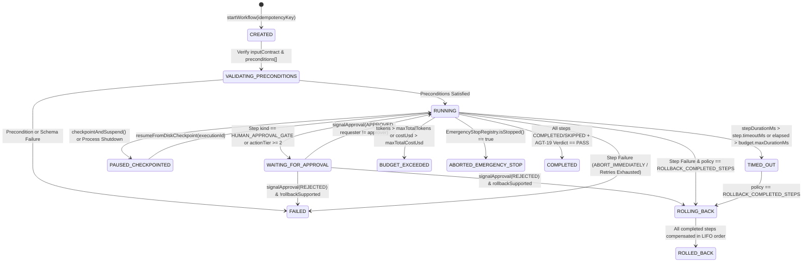

# AETHER FORGE — DURABLE EXECUTION STATE MACHINE (`EXECUTION_STATE_MACHINE.md`)

- **Version:** `1.0.0`
- **Subsystem:** `ARCH-06` (Integration and Orchestration Engine)
- **Implementation:** [WORKFLOW_ENGINE/src/index.ts](file:///C:/Users/blago/Desktop/AETHERFORGE/WORKFLOW_ENGINE/src/index.ts) & [ORCHESTRATION_ENGINE/src/index.ts](file:///C:/Users/blago/Desktop/AETHERFORGE/ORCHESTRATION_ENGINE/src/index.ts)
- **Schemas:** [WORKFLOW_SCHEMA/workflow-schema.ts](file:///C:/Users/blago/Desktop/AETHERFORGE/WORKFLOW_SCHEMA/workflow-schema.ts)
- **Verification Suite:** [WORKFLOW_TESTS/workflow-orchestration.test.ts](file:///C:/Users/blago/Desktop/AETHERFORGE/WORKFLOW_TESTS/workflow-orchestration.test.ts)

---

## 1. Workflow Lifecycle State Machine

Every workflow instance (`executionId`) transitions deterministically across **12 formal lifecycle states**. Every transition is written to a hash-chained disk **Write-Ahead Log (`<executionId>.wal.jsonl`)** and an atomic **Checkpoint Snapshot (`<executionId>.checkpoint.json`)** before control returns.

---

## 2. Step-Level Execution State Machine & Execution Topology Modes

Each `WorkflowStepSpec` transitions through:
`PENDING` → `READY` (all `dependsOnStepIds` are `COMPLETED`) → `RUNNING` | `WAITING_FOR_APPROVAL` | `SKIPPED_CONDITION_FALSE` → `COMPLETED` | `FAILED` | `TIMED_OUT` → `ROLLED_BACK`.

### Supported Workflow Topologies
1. **Sequential Workflows (`SEQUENTIAL_TASK`):** Steps execute in topological order ($S_1 \to S_2 \to \dots \to S_n$). Each step receives a monotonically increasing 64-bit `fenceToken` and inherits committed `outputContext` keys from predecessors.
2. **Parallel Workflows (`PARALLEL_GROUP`):** Steps sharing a ready frontier (or grouped under `parallelBranchStepIds`) execute concurrently via `Promise.all` **only after** the engine verifies pairwise disjointness of `exclusiveWriteGlobs`:
   $$\forall S_i, S_j \in \text{ParallelFrontier} \; (i \ne j): \quad \text{exclusiveWriteGlobs}(S_i) \cap \text{exclusiveWriteGlobs}(S_j) = \emptyset$$
   Any overlap aborts the parallel dispatch with `CONCURRENT_WRITE_GLOB_CONFLICT`.
3. **Conditional Branching (`CONDITIONAL_BRANCH`):** Evaluates `step.condition` (`contextKey`, `operator: EQUALS | NOT_EQUALS | IN`, `value`) against the workflow's deterministic runtime context. The inactive branch steps transition directly to `SKIPPED_CONDITION_FALSE`, allowing downstream join nodes to resolve cleanly.
4. **Nested Workflows (`NESTED_WORKFLOW`):** Spawns a child workflow (`nestedWorkflowId`) at `nestingDepth = parent.nestingDepth + 1` (bounded at `maxNestingDepth = 2`), propagating `tenantId`, `projectId`, and remaining execution budget while isolating child step checkpoints under `<parentExecutionId>__sub__<stepId>`.
5. **Human Approval Gates (`HUMAN_APPROVAL_GATE` / `actionTier >= 2`):** Transitions the step and workflow to `WAITING_FOR_APPROVAL`, flushes the checkpoint to disk, and suspends execution. Resumption requires a signed human decision enforcing **Self-Approval Prohibition (`requesterId !== approverPrincipalId`)**.
6. **Independent Verification Gate (`INDEPENDENT_VERIFICATION_GATE`):** Mandatory terminal node assigned to `AGT-19` (`independent-verification-agent`) verifying that all required evidence bindings (`FILE_SHA256_BINDING`, `COMMAND_EXIT_CODE_ZERO`, `AUDIT_CHAIN_HASH`) are present and valid.

---

## 3. Determinism, Idempotency & Fencing Invariants

| Invariant ID | Formal Rule | Enforcement Mechanism |
| :--- | :--- | :--- |
| **`INV-SM-01` (Idempotent Start & Step Execution)** | Re-submitting `startWorkflow` or `signalApproval` with an already-processed `idempotencyKey` returns the existing `DurableWorkflowCheckpoint` with zero duplicate side effects. | `checkpoint.processedIdempotencyKeys[]` persisted in disk checkpoint before returning. |
| **`INV-SM-02` (Monotonic Fence Token Ordering)** | Every step dispatch increments `checkpoint.currentFenceToken` ($f_{k+1} = f_k + 1$). Any concurrent worker attempting a write with $f \le \text{maxSeenFenceToken}(path)$ is rejected. | `OrchestrationEngine.acquirePathLease()` rejects stale tokens with `STALE_FENCE_TOKEN_REJECTED`. |
| **`INV-SM-03` (WAL Hash Chain Integrity)** | Every WAL event $E_n$ binds to $E_{n-1}$ via $\text{walEntryHash}_n = \text{SHA256}(\text{prevWalHash}_{n-1} \parallel \text{canonicalJson}(E_n))$. | Verified on every `resumeFromDiskCheckpoint()` call; tampered WAL logs throw `WAL_HASH_CHAIN_TAMPERED`. |
| **`INV-SM-04` (Crash-Safe Checkpoint Atomicity)** | If the process terminates after step $S_k$ completes, reloading `<executionId>.checkpoint.json` resumes at $S_{k+1}$ without re-invoking $S_1 \dots S_k$. | Synchronous disk flush (`writeFileSync`) after every state transition. |
