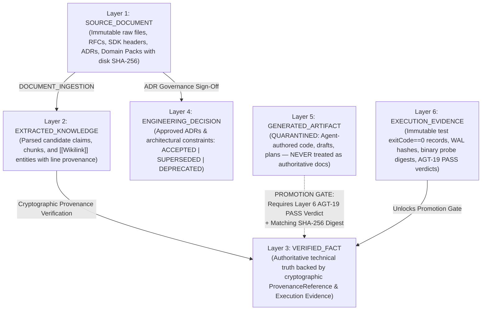

# AETHER FORGE — KNOWLEDGE & MEMORY GOVERNANCE SPECIFICATION (`KNOWLEDGE_GOVERNANCE.md`)

- **Version:** `1.0.0`
- **Authority:** Chief Knowledge and Memory Architect (`ARCH-02` Expert Knowledge Engine & `ARCH-08` Project Memory)
- **Traceability:** `REQ-F-0200..0211`, `REQ-NF-0200..0201`, `ADR-0007`
- **Subsystems:** [KNOWLEDGE_ENGINE/](file:///C:/Users/blago/Desktop/AETHERFORGE/KNOWLEDGE_ENGINE/README.md), [MEMORY_ENGINE/](file:///C:/Users/blago/Desktop/AETHERFORGE/MEMORY_ENGINE/README.md), [DOCUMENT_INGESTION/](file:///C:/Users/blago/Desktop/AETHERFORGE/DOCUMENT_INGESTION/README.md), [RETRIEVAL_ENGINE/](file:///C:/Users/blago/Desktop/AETHERFORGE/RETRIEVAL_ENGINE/README.md), [PROJECT_CONTEXT_ENGINE/](file:///C:/Users/blago/Desktop/AETHERFORGE/PROJECT_CONTEXT_ENGINE/README.md)

---

## 1. Six-Layer Epistemic Separation Model

To eliminate **Ouroboros Hallucination Loops** (where an AI system ingests its own unverified generated text or code and later retrieves it as authoritative technical documentation), AETHER FORGE enforces a strict **Six-Layer Epistemic Partition**:

### Layer Authority & Retrieval Quarantine Rules

| Epistemic Layer | Authoritative for Ground-Truth RAG? | Can Be Cited as `verified_facts`? | Promotion / Admission Requirement |
| :--- | :--- | :--- | :--- |
| **`1. SOURCE_DOCUMENT`** | Yes (Primary Source) | Yes (via chunk provenance) | Valid on-disk or signed URI `SHA-256` digest. |
| **`2. EXTRACTED_KNOWLEDGE`** | Provisional | Only after provenance check | Extracted deterministically from a `SOURCE_DOCUMENT` with exact line/offset range. |
| **`3. VERIFIED_FACT`** | **Yes (Authoritative)** | **Yes** | Bound to a non-empty `SourceReference` + verified `SHA-256` or Layer 6 `EXECUTION_EVIDENCE`. |
| **`4. ENGINEERING_DECISION`** | **Yes (Normative Rule)** | **Yes** | Signed ADR (`ADR-0001..0012`) with status `ACCEPTED`. |
| **`5. GENERATED_ARTIFACT`** | **NO (Quarantined)** | **FORBIDDEN** | Excluded from all `authoritativeOnly: true` retrievals. Cannot be promoted to `VERIFIED_FACT` without a Layer 6 `AGT-19` `PASS` verdict matching the artifact's `SHA-256`. |
| **`6. EXECUTION_EVIDENCE`** | **Yes (Empirical Proof)** | **Yes** | Immutable runtime log (`exitCode === 0`, `auditEntryHash`, `verifierAgentId === "AGT-19"`). |

---

## 2. Supported Knowledge & Memory Scopes

1. **`GLOBAL_TECHNICAL_KNOWLEDGE`:** Cross-project foundational specifications (ISO C++20, ITU-R BS.1770-4, Steinberg VST3 SDK 3.7, OpenAPI 3.1, W3C TraceContext).
2. **`DOMAIN_KNOWLEDGE_PACK`:** Modular domain corpora (`DOMAIN_KNOWLEDGE_PACKS/audio-domain-knowledge-pack.json`).
3. **`PROJECT_MEMORY`:** Project-specific goals, active brief hashes, component registries, and tenant configuration.
4. **`ARCHITECTURE_DECISION_RECORD`:** Versioned ADR registry (`ADR-0001..0012`) with supersession lineage.
5. **`ENGINEERING_HISTORY`:** Chronological ledger of commits, workflow runs, rollbacks, and release promotions.
6. **`AGENT_SCRATCHPAD_MEMORY`:** Isolated working memory per specialist agent (`memory://<tenantId>/<projectId>/<agentId>/*`) invisible to sibling agents unless published via a `SharedContextEnvelope`.
7. **`RESEARCH_EVIDENCE`:** Workstation binary probe records (`FL64.exe`, `csc.exe`, `cmake.exe`) authored by `AGT-02`.
8. **`DOCUMENTATION_INDEX`:** Live symbol, heading, and `[[Wikilink]]` graph index across repository Markdown documents.

---

## 3. Provenance, Versioning & Conflict Detection

### 3.1 Mandatory Provenance & Version Chain
Every `KnowledgeRecord` enforces:
- `recordId`: Canonical identifier (e.g., `KREC-0001`).
- `version`: Monotonically increasing integer (`1, 2, ...`). Updating a record never overwrites history in place; it creates version $v+1$ with `previousVersionHash` pointing to version $v$'s `recordSha256`.
- `sourceRef`: `{ sourceUri, sourceSha256, lineStart, lineEnd, capturedAt }`.
- `canonicalSubject` & `canonicalPredicate` & `canonicalValue`: Structured triple `(subject, predicate, value)` enabling deterministic conflict detection.

### 3.2 Automated Conflict Detection (`detectKnowledgeConflicts`)
Whenever a new record is ingested or updated, `KnowledgeEngine` compares its `(canonicalSubject, canonicalPredicate)` against existing active authoritative records (`VERIFIED_FACT` and `ENGINEERING_DECISION`):
- If two active records share `(tenantId, canonicalSubject, canonicalPredicate)` but assert incompatible `canonicalValue` strings without an explicit `supersedesRecordId` link, the engine emits a `KnowledgeConflictDiagnostic` (`CONFLICT_CONTRADICTORY_AUTHORITATIVE_CLAIMS`) and blocks unreviewed context injection.

---

## 4. Obsidian-Compatible Markdown Portable Knowledge Vault

Every record in `KNOWLEDGE_ENGINE` can be exported to and imported from an **Obsidian-compatible Markdown Vault** (`<vaultDir>/<layer>/<recordId>.md`):
- **YAML Frontmatter:** Carries `recordId`, `layer`, `scope`, `version`, `previousVersionHash`, `canonicalSubject`, `canonicalPredicate`, `canonicalValue`, `sourceUri`, `sourceSha256`, and `recordSha256`.
- **Bidirectional `[[Wikilinks]]`:** Automatically indexes outbound `[[TargetId]]` links and computes inbound `backlinks[]` across ADRs, requirements (`[[REQ-F-0101]]`), components (`[[COMP-0001]]`), and domain knowledge packs (`[[DKP-DSP-001]]`).
- **Epistemic Callouts:** Renders `> [!IMPORTANT] VERIFIED_FACT` or `> [!WARNING] GENERATED_ARTIFACT (UNVERIFIED — QUARANTINED)` so human engineers browsing the Obsidian vault immediately see epistemic authority.
