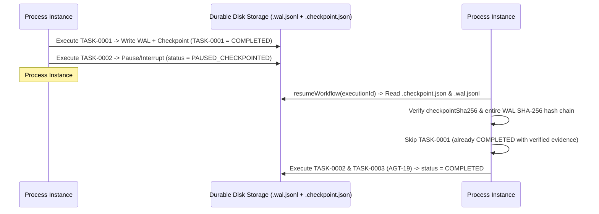

# AETHER FORGE — DURABLE WORKFLOW RECOVERY, RETRY & ROLLBACK FRAMEWORK (`RECOVERY_FRAMEWORK.md`)

- **Version:** `1.0.0`
- **Subsystem:** `ARCH-06` (Integration and Orchestration Engine)
- **Implementation:** [WORKFLOW_ENGINE/src/index.ts](file:///C:/Users/blago/Desktop/AETHERFORGE/WORKFLOW_ENGINE/src/index.ts)
- **Verification Suite:** [WORKFLOW_TESTS/workflow-orchestration.test.ts](file:///C:/Users/blago/Desktop/AETHERFORGE/WORKFLOW_TESTS/workflow-orchestration.test.ts)

---

## 1. Durable Persistence & Crash Recovery Protocol

To guarantee that workflow state survives process restarts and power failures without state corruption or duplicate step execution, `DurableWorkflowEngine` implements a **Two-Tier Disk Persistence Architecture**:

1. **Hash-Chained Write-Ahead Log (`<checkpointDir>/<executionId>.wal.jsonl`):**
   - Before and after every step transition (`STEP_STARTED`, `STEP_RETRY_SCHEDULED`, `STEP_COMPLETED`, `STEP_FAILED`, `STEP_ROLLED_BACK`, `CHECKPOINT_SAVED`), an append-only JSONL record is flushed to disk.
   - Each record includes `prevWalHash` and `walEntryHash` (SHA-256).
2. **Atomic Checkpoint Snapshot (`<checkpointDir>/<executionId>.checkpoint.json`):**
   - Contains the complete `DurableWorkflowCheckpoint` state (`stepStates`, `currentFenceToken`, `consumedTokens`, `consumedCostUsd`, `inputContext`, `outputContext`, `processedIdempotencyKeys`, `walHeadHash`, and `checkpointSha256`).

### Process Restart & Safe Resume Sequence

---

## 2. Retry Backoff & Failure Classification

When a step handler returns an error or throws an exception, `DurableWorkflowEngine` inspects the step's `StepFailurePolicy`:

| Failure Policy (`onFailure`) | Behavior | Terminal Workflow State if Exhausted |
| :--- | :--- | :--- |
| **`RETRY_WITH_BACKOFF`** | Retries step up to `maxAttempts` (`1..5`) with deterministic delay $\Delta t_k = \text{backoffMs} \times 2^{k-1}$. Logs `STEP_RETRY_SCHEDULED` in WAL on each retry. If attempt $k \le \text{maxAttempts}$ succeeds, workflow continues normally. | `ROLLING_BACK` → `ROLLED_BACK` (if `rollbackSupported === true`) or `FAILED` |
| **`ROLLBACK_COMPLETED_STEPS`** | Immediately aborts forward progress and initiates LIFO compensating rollback across all previously completed steps. | `ROLLED_BACK` |
| **`ESCALATE_TO_HUMAN`** | Suspends workflow in `WAITING_FOR_APPROVAL`, persists diagnostic evidence, and awaits human operator remediation or abort decision. | `WAITING_FOR_APPROVAL` |
| **`ABORT_IMMEDIATELY`** | Immediately halts workflow in `FAILED` state without retry or rollback, preserving exact disk forensics for inspection. | `FAILED` |

---

## 3. LIFO Compensating Saga Rollback Engine

When a step fails after exhausting its retry budget (or when a human operator rejects an approval gate) and `rollbackSupported === true`:
1. The workflow transitions to `ROLLING_BACK`.
2. The engine collects all steps currently in state `COMPLETED` that have `failurePolicy.rollbackSupported === true`.
3. It sorts those steps in **strict reverse completion order (LIFO — Last-In, First-Out)** based on `assignedFenceToken` descending.
4. For each step, the engine invokes the registered compensating rollback handler (`onRollbackStep(stepSpec, stepState)`), restores leased paths using `rollbackCommandHint`, records `STEP_ROLLED_BACK` in the WAL, and updates the step status to `ROLLED_BACK`.
5. Once all prior steps are compensated, the workflow transitions to `ROLLED_BACK` and flushes the final checkpoint to disk.

---

## 4. Timeout & Execution Budget Circuit Breakers

Every workflow enforces three quantitative resource ceilings (`WorkflowBudgetSpecSchema`):
1. **Per-Step & Total Wall-Clock Timeout (`timeoutMs` / `budget.maxDurationMs`):**
   - If a step's execution time exceeds `step.timeoutMs`, the step is preempted with `STEP_TIMED_OUT` and the workflow transitions to `TIMED_OUT` (or triggers LIFO rollback if configured).
2. **Token Budget Ceiling (`budget.maxTotalTokens`):**
   - After each step, `consumedTokens += stepEvidence.tokensConsumed`. If `consumedTokens > budget.maxTotalTokens`, execution halts immediately with status `BUDGET_EXCEEDED` and WAL event `WORKFLOW_BUDGET_EXCEEDED`.
3. **USD Cost Ceiling (`budget.maxTotalCostUsd`):**
   - After each step, `consumedCostUsd += stepEvidence.costUsdConsumed`. If `consumedCostUsd > budget.maxTotalCostUsd`, execution halts immediately with status `BUDGET_EXCEEDED`.
