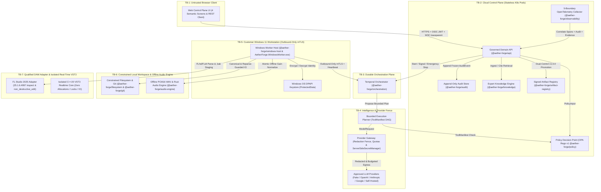
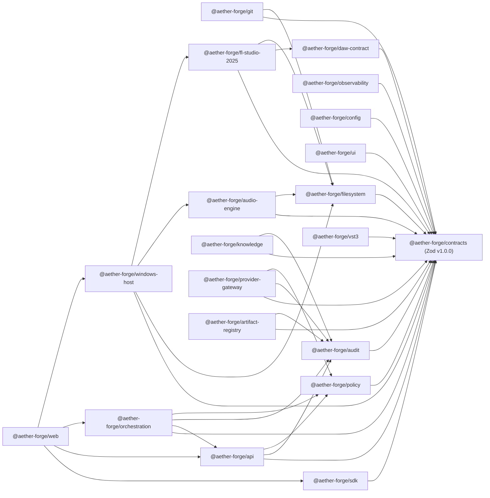
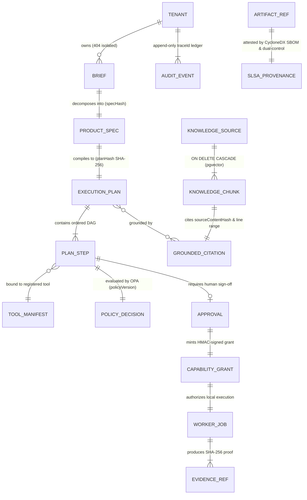
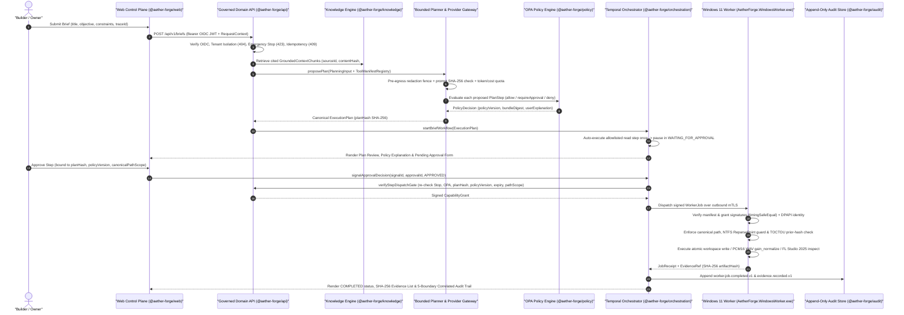
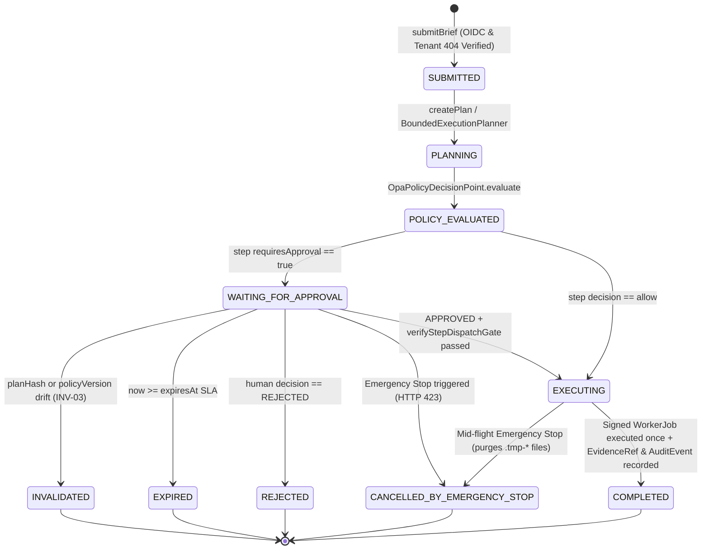

# AETHER FORGE — System Architecture Diagrams

**Version:** 1.0.0  
**Date:** 2026-11-23  
**Status:** Verified Architecture Visualizations (`v1.0.0`)  
**Cross-References:** [MASTER_ARCHITECTURE.md](./MASTER_ARCHITECTURE.md) · [MODULE_CATALOG.md](./MODULE_CATALOG.md) · [INTERFACE_CONTRACTS/README.md](./INTERFACE_CONTRACTS/README.md) · [REFERENCE_BOOK.md](./REFERENCE_BOOK.md)

---

## 1. Hybrid System Architecture & Trust Boundaries (`TB-1` .. `TB-7`)

---

## 2. Monorepo Module Dependency Graph

---

## 3. Data Flow & Evidence Provenance Architecture

---

## 4. End-to-End Governed Execution Lifecycle

---

## 5. Approval & Workflow State Machine (`INV-03`)

